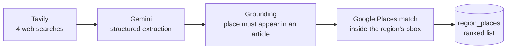
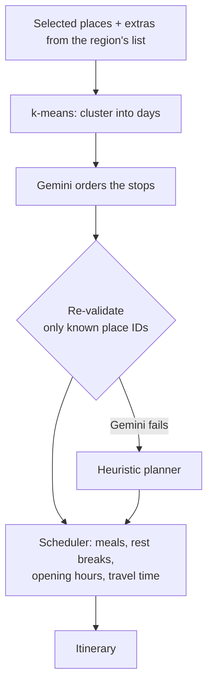
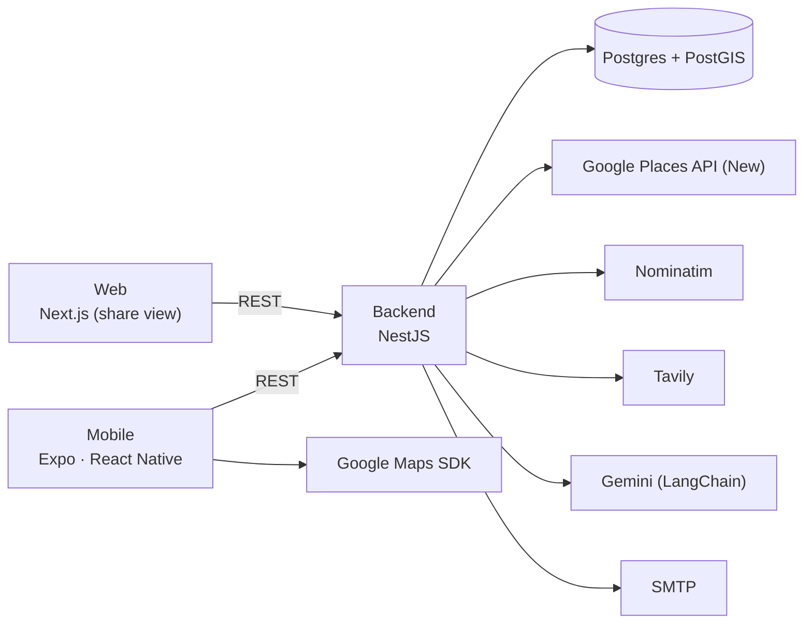

<div align="center">

# 🧭 Rong

### *Rong thong dong.*

**Discover places and build travel itineraries across Vietnam — in seconds, not hours.**

[](#-architecture)
[](#-architecture)
[](#-places-one-list-per-region-from-web-articles)
[](#-status)

</div>

---

## 😮‍💨 The problem

You saved 47 TikToks about Đà Lạt, scrolled three Facebook review groups, opened twelve blog tabs — and still ended up typing an itinerary into Notes at 1 AM while the group argued in Zalo.

**Too much information. Not enough plan.**

## ✨ What Rong does

> 🔍 **Search** a destination — old or new province name, with or without diacritics.
>
> 📍 **Browse** a list of places for that region, compiled from travel articles on the web and pinned on Google Maps.
>
> ❤️ **Save** what you like to *Muốn đi* — or share a TikTok / Facebook / Instagram link into the app and let Rong find the places in it.
>
> 🤖 **Plan** a trip with AI (or by hand): days, stops, meals, rest breaks and travel times worked out for you.
>
> 🔗 **Share** a read-only link that opens in any browser — no app install needed.

---

## 🎯 Features

### 🗺️ Destination search (F1)

- **Speaks Vietnamese:** type `da lat`, get **Đà Lạt**. Diacritics are folded and matching is fuzzy (`pg_trgm`).
- **July 2025 province merger:** provinces both before and after the merger are seeded, clearly labeled, with their bounding boxes.
- **Popular destinations** (including former districts such as Cần Giờ, Củ Chi) are seeded with aliases, so they're found instantly.
- **Online fallback:** when you press search and nothing matches, Rong asks Nominatim (OpenStreetMap) and imports the result.

### 📍 Places: one list per region, from web articles (F2)

Each region gets a single ranked list of places, built from real travel articles:



- The first visit builds the list (10–30 s); the app shows a *"building"* state and polls. Concurrent visitors share one run.
- Lists refresh in the background after 30 days; the old list stays if a refresh fails.
- A place is kept only if an article actually mentions it. Places Google can't match keep the AI's coordinates — only if they fall inside the region — and are marked **"Vị trí gần đúng"** (approximate location).
- Category chips: Check-in · Food · Cafés · Nature · Kid-friendly · Culture & history · Nightlife · Stays.
- **Search by name inside a region:** matches the region's list while typing, and Google Text Search on submit (per-user daily limits).

### 🏷️ Place details (F5)

Rong's own name, category and description from articles, plus **live** Google Maps content — rating, reviews, opening hours, photos — fetched only when you open a place, never stored, and attributed to Google Maps.

### 📲 Share-to-app (F4)

Hit **Share → Rong** on a TikTok, Facebook or Instagram post (or paste text). A background job reads the link's public metadata (oEmbed / Open Graph), extracts place names with Gemini and matches each one to a known place or to Google. Pick the ones you want and they land in *Muốn đi*.

### 🧠 Itineraries (F6, F8, F9)

Choose **AI planning** or **manual planning**, then set dates and times, who's coming, headcount, where you're staying, budget, pace and transport.



- **The AI can't invent places:** it only sees IDs from the database, and its output is fully re-validated (FR-6.3).
- **Group-aware rules:** families with young kids, friends, couples and elderly travelers get different stops-per-day, rest breaks and preferences.
- **Automatic meal slots** — breakfast, lunch, dinner — inside fixed windows.
- **Edit like a playlist:** reorder and move stops between days; every edit is re-timed and returns **advisory warnings** (long leg, long day, missing meal, place closed) that never block saving.
- **"Swap for something similar"** suggests nearby alternatives.
- **Share links:** a read-only public view at `/t/<token>` on the web app; links can be revoked.

### 👥 Groups (backend, F10)

Groups, invite links, roles (**owner · editor · viewer**), a shared place list and an activity log. An itinerary can be moved into a group. All permission rules live in one file (`groups/access.ts`); a caller who can't see a resource gets 404, not 403.

### 🔐 Accounts (F11)

Email + password (argon2id) with a 6-digit email verification code. Short-lived JWT access tokens plus rotating refresh tokens (reuse revokes the whole family). Users can **delete their account and data from inside the app**.

---

## 🚦 Status

| Area | State |
| --- | --- |
| Destination search, old/new provinces | ✅ Backend + mobile |
| Region place lists (Tavily + Gemini + Google matching) | ✅ Backend + mobile |
| Place details with live Google content, search by name | ✅ Backend + mobile |
| *Muốn đi* saved list, share-to-app | ✅ Backend + mobile |
| AI / manual itineraries, editing, alternatives, warnings | ✅ Backend + mobile |
| Public share link | ✅ Backend + web (`/t/[token]`) |
| Groups, invites, roles, activity log | ✅ Backend · ⏳ mobile UI |
| Cost estimates (F7), composite ranking (F3), real-time sync | ⏳ Planned (`ranking/`, `realtime/` are placeholders) |
| Google Routes travel times | ⏳ Planned (travel time is estimated for now) |
| Google / Apple sign-in | ⏳ Planned (`auth_identities` is ready for it) |

---

## 🧰 Architecture

TypeScript end to end, in a **pnpm + Turborepo** monorepo.



| Layer | Technology |
| --- | --- |
| 📱 **Mobile** | Expo SDK 57 · React Native · expo-router · `react-native-maps` (Google provider) · `expo-share-intent` |
| 🌐 **Web** | Next.js 16 App Router · Tailwind 4 — public itinerary view |
| ⚙️ **Backend** | NestJS 12 · TypeORM · global JWT guard · `ValidationPipe` |
| 🗄️ **Database** | PostgreSQL 16 + PostGIS · `pg_trgm` · hand-written SQL migrations |
| 🧠 **AI** | Gemini through LangChain (structured output, agents) · Tavily web search |
| 🗺️ **Maps data** | Google Places API (New) · Nominatim (OSM) · seeded province bounding boxes |
| 🧪 **Tests** | Vitest (unit + e2e against a real database) · oxlint · Prettier |

**Architectural rules**

- Clients **never** talk to the database or third-party APIs directly. Everything goes through the NestJS backend.
- Each external service sits behind **one gateway**: `open-data/` (Nominatim), `google/` (Google Places), `share-import/LinkMetadataService` (user links, with SSRF protection), `src/langchain/` (Gemini, Tavily).
- Errors are Nest exceptions with a `{ code, message }` body; clients match on `code`.

### ⚖️ Google Maps Platform compliance (PRD §7.4)

- Only `place_id` is stored indefinitely; Google coordinates are cached for **at most 30 days**.
- Ratings, reviews, photos and opening hours are fetched **live**, only on the place detail screen, and attributed to Google Maps.
- **Nothing is ranked or sorted on Google data** — lists come from Rong's own `region_places`.
- Names and descriptions in the list come from web articles, not from Google.

---

## 📦 Repository layout

```text
rong/
├── apps/
│   ├── mobile/          Expo SDK 57 · React Native · expo-router (screens in src/app)
│   ├── web/             Next.js 16 · public itinerary view at /t/[token]
│   └── backend/         NestJS 12 · TypeORM · PostGIS
│       └── src/
│           ├── modules/     auth, users, regions, places, google, open-data,
│           │                share-import, saved-places, itineraries, groups,
│           │                mail, health, ranking*, realtime*   (* placeholders)
│           ├── langchain/   Gemini + Tavily place search
│           └── database/    migrations
├── packages/
│   └── shared-types/    The API contract shared by all three apps
├── infra/
│   ├── docker-compose.yml   PostGIS 16 + Redis 7 for local dev
│   └── prod/                EC2 + Caddy + Docker Compose
├── docs/
│   ├── PRD-Rong.md          Product spec (Vietnamese)
│   └── superpowers/         Design specs and plans for larger backend slices
└── .github/workflows/
    ├── release-apk.yml      Builds the Android APK on v* tags
    └── deploy-backend.yml   Backend deploy (currently a placeholder)
```

The backend module map, flows and deliberate PRD deviations are documented in
[`apps/backend/src/modules/README.md`](./apps/backend/src/modules/README.md).

---

## 🏁 Getting started

Requires **Node 24**, **pnpm**, and **Docker**.

```bash
pnpm install
pnpm infra:up                 # PostGIS on host port 5433 (not 5432), Redis on 6379

# Backend — http://localhost:3001/api
cp apps/backend/.env.example apps/backend/.env   # JWT_SECRET must be ≥ 32 chars
pnpm --filter @rong/backend migration:run
pnpm --filter @rong/backend start:dev
curl http://localhost:3001/api/health            # reports the live PostGIS version

# Web — http://localhost:3000
pnpm --filter @rong/web dev

# Mobile — Metro, or native builds
cp apps/mobile/.env.example apps/mobile/.env
pnpm --filter @rong/mobile start                 # or: android / ios
```

### Environment variables

Each app ships a `.env.example`; no keys are committed.

| App | Key variables |
| --- | --- |
| Backend | `JWT_SECRET`, `DB_*`, `GOOGLE_MAPS_API_KEY`, `GEMINI_API_KEY`, `TAVILY_API_KEY` (without it, place lists return 503), `SMTP_*` (empty → emails are logged), `OPEN_DATA_CONTACT_EMAIL`, daily limits (`PLACE_SEARCH_DAILY_LIMIT`, `PLACE_DETAILS_DAILY_LIMIT`, `SHARE_IMPORT_DAILY_LIMIT`), `WEB_PLACES_REFRESH_DAYS`, `WEB_PLACES_WAIT_MS` |
| Mobile | `EXPO_PUBLIC_API_BASE_URL`, `GOOGLE_MAPS_ANDROID_API_KEY`, `GOOGLE_MAPS_IOS_API_KEY` (read at Expo config time) |

### Workspace tasks

| Command | Does |
| --- | --- |
| `pnpm build` | Build every workspace through Turborepo |
| `pnpm typecheck` | Type-check every workspace |
| `pnpm lint` | Lint every workspace |
| `pnpm test` | Run all unit tests |
| `pnpm infra:up` / `infra:down` | Start / stop Postgres + Redis |
| `pnpm --filter @rong/backend test:e2e` | Backend e2e tests against a migrated database |

> `@rong/shared-types` is consumed from its `dist/`. The backend's scripts build it for you; if you run `vitest` or `tsc` directly after changing it, run `pnpm build:deps` first.

---

## 🚢 Release & deploy

- **Android APK:** pushing a tag matching `v*` (e.g. `v1.1.0`) runs [`release-apk.yml`](./.github/workflows/release-apk.yml), which builds the APK locally with EAS (`release` profile) and attaches `rong-<tag>.apk` to a GitHub Release. Manual runs keep the APK as a workflow artifact.

  ```bash
  git tag v1.1.0 && git push origin v1.1.0
  ```

- **Backend:** `apps/backend/Dockerfile` builds from the repo root and runs migrations on start. `infra/prod/` holds the EC2 + Caddy + Docker Compose setup — see its README.

---

## 📄 Documentation

- [`docs/PRD-Rong.md`](./docs/PRD-Rong.md) — the Product Requirements Document (Vietnamese). Feature IDs (F1, FR-6.3, §7.4) refer to it.
- [`apps/backend/src/modules/README.md`](./apps/backend/src/modules/README.md) — backend module map and flows.
- [`docs/superpowers/`](./docs/superpowers) — design specs and implementation plans.
- [`apps/mobile/CLAUDE.md`](./apps/mobile/CLAUDE.md) — mobile screen and keyboard conventions.

## 🙏 Attribution

Map and boundary data: **© OpenStreetMap contributors** (ODbL).
Ratings, reviews, photos, opening hours and live place information: **Google Maps Platform**.
Place lists are compiled from public travel articles found via Tavily.

<div align="center">

---

**Rong** — *Rong thong dong.*

</div>
